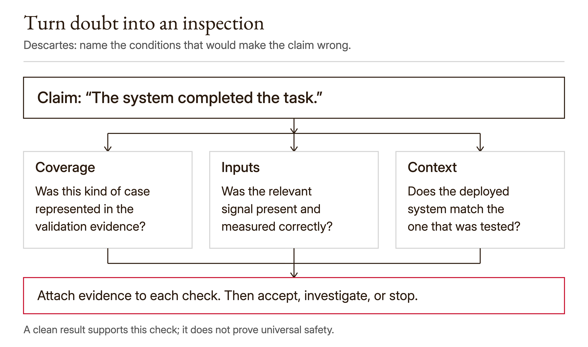
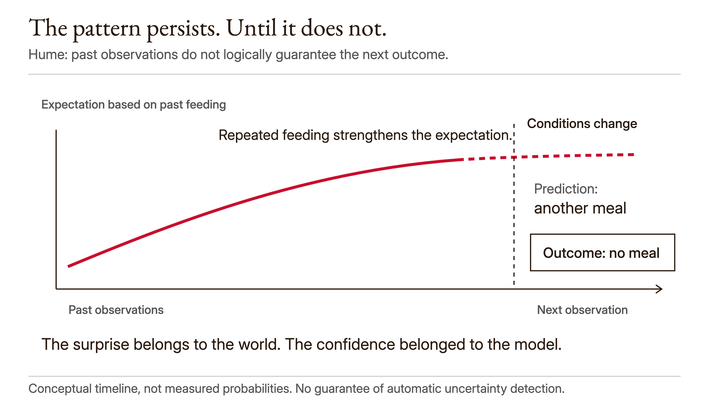
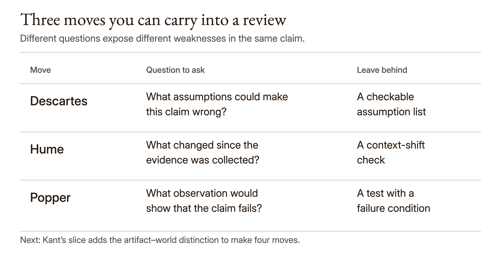
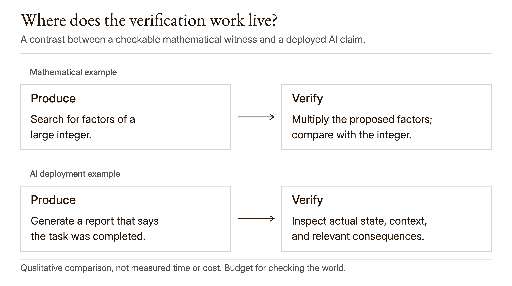
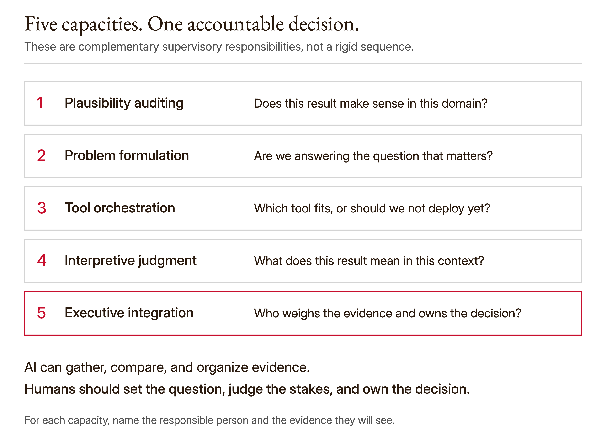
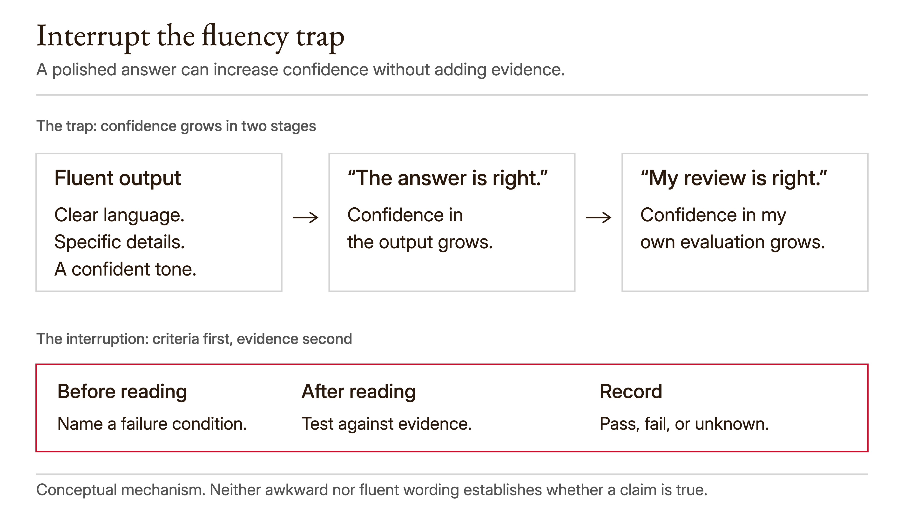
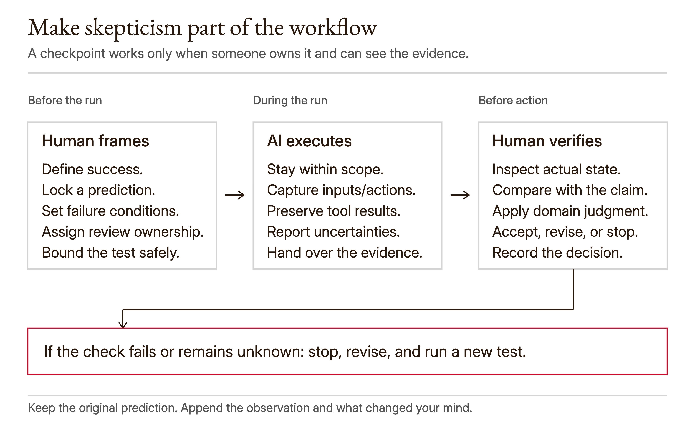

# Chapter 1 — The Skeptic's Toolkit

*The moves you perform before you trust what the machine just told you.*

---

In October 2006, Netflix offered a million dollars to anyone who could beat its own movie recommender by ten percent. "Beat" had a precise meaning. Predict, more accurately than Netflix's system did, the star rating a customer would give a movie, and be scored by how far your predictions landed from ratings you had never seen. Netflix released about a hundred million real ratings with the customers' names removed, and thousands of teams went to work. It took nearly three years. At the end, two coalitions of researchers tied on the hidden test data, and under the rules the prize went to the team that had submitted first, about twenty minutes earlier.

Netflix did put ideas from the contest to work: two algorithms from the 2007 Progress Prize went into production. It never deployed the system that won the million. Its own engineers explained why in 2012: the extra accuracy did not seem to justify the engineering effort, and by then the company's focus had moved on (Amatriain & Basilico, "Netflix Recommendations: Beyond the 5 Stars," Netflix Technology Blog, 2012). Netflix had become a streaming company, and what it needed to know was no longer what you would rate a movie. It was whether you would find something to watch tonight, and whether you would still be paying next month. The contest had also gone wrong in a way no leaderboard could show. Two researchers matched the "anonymous" ratings against public ratings on IMDb and showed that someone who knew a little about a subscriber could find that subscriber's record (Narayanan & Shmatikov, "Robust De-anonymization of Large Sparse Datasets," 2008). Netflix was sued, and in March 2010 it cancelled the second contest it had planned. In 2017 it retired the five-star scale itself.

Netflix got exactly the number it paid for. By the time the number arrived, it was no longer the number worth having.

Now raise the stakes. Between 2014 and 2017, Amazon built an experimental system to rate job candidates from one to five stars, the way shoppers rate products. Its models learned from patterns in the résumés submitted to the company over a decade — most of them from men, reflecting the tech industry's male dominance. According to people familiar with the project, the system penalized résumés that contained the word "women's," as in "women's chess club captain," downgraded graduates of two all-women's colleges, and favored verbs that were more common on men's engineering résumés. It also learned to give little weight to skills nearly every technical applicant shared, such as writing code — the very skill the job required — because a model built to tell résumés apart rewards whatever differs between them, not whatever matters. By 2015 the company had realized the tool was not rating technical candidates in a gender-neutral way. Amazon edited the programs to be neutral to the specific terms it had found, but could not be sure the models would not find other ways to sort candidates. With results reportedly coming back almost at random, executives lost hope, and the team was disbanded by the start of 2017. Amazon's statement was that the tool "was never used by Amazon recruiters to evaluate candidates." (Dastin, "Amazon scraps secret AI recruiting tool that showed bias against women," Reuters, October 10, 2018.)

Almost everything we know about this case comes from that one report and its anonymous sources. As far as I can find, no code, training data, or documentation has ever been released. Notice, too, what the report does not say: what the models were trained to predict. Hired? Advanced? Rated highly by a recruiter? We do not know. You cannot audit a measure you cannot see, and that is a lesson of its own.

Two systems. In one, a company paid for a number, got it, and found that the number had stopped being the thing it needed to know. In the other, a system learned what its training data taught it, and what the data taught was the wrong thing.

Now, neither system was broken. I want you to sit with that for a second, because it is the whole point. The Netflix contest worked exactly as designed: somebody delivered the improvement it asked for, to four decimal places. The Amazon models worked as models trained to tell résumés apart work: they learned the patterns in their training data, and the patterns were real. They were a record of who had applied, not of who could do the job. Each system was aimed at something that stood in for what anyone actually cared about. Netflix aimed at rating error and cared about whether you would find something to watch and keep paying. Amazon's models aimed at resemblance to a decade of résumés, and the company cared about who could do the work.

Both failures share a structure that runs through this entire book. The system measured one thing. Everyone cared about another. The output was valid on the first and wrong about the second, and nothing on the dashboard could tell the difference. The gap between those two things is what this book is about.

Aggregate lessons are hard to feel, so for the rest of this chapter, hold one person in mind. She is a composite — not a real applicant, but the kind of case a measure like that is made of. A software engineer with five years of shipping code, who captained her university's women's chess club. Her résumé carries the one skill the job requires, but so do nearly all the other résumés in the pile, so a model built to tell résumés apart gives it little weight. It also carries a phrase the model learned to mark down. Imagine anyone leaning on a ranking like that: she sinks toward the bottom of the stack, and nobody ever learns the stack was wrong. I have to be careful here. The reporting does not say the tool rejected anyone; she is what leaning on such a ranking would cost, not a record of what happened. That is what one wrong score looks like from the inside, and it is the illustration we will return to as we build the toolkit.

---

**What you will be able to do after this chapter:** By the end you should be able to take any AI system and state what it measures, what the people who built it actually care about, and whether the two have come apart; to take any AI output and apply four skeptical moves to it — Cartesian doubt, Humean induction limits, Popperian falsifiability, and the Kantian slice move; to name and distinguish the Five Supervisory Capacities required to catch the failures that metrics cannot see; to identify the Fluency Trap and interrupt it before it does epistemic work it should not do; and to take any AI deployment failure and map it to the supervisory capacity whose absence allowed it.

**Prerequisites:** Familiarity with the basics of supervised machine learning (training sets, validation sets, accuracy metrics) is helpful but not required. The conceptual tools in this chapter do not depend on any mathematics — those come in Chapter 2.

**Why this chapter first:** Everything else in this book is downstream of what this chapter teaches. If you do not have the four moves and the five capacities, you do not yet have the vocabulary for the rest of the book.

---

## What you measure and what you care about

Look at the two openers again and ask the same question of each: what was the system measuring, and what did anyone actually want?

| | What the system measured | What anyone cared about |
|---|---|---|
| **Netflix Prize** | Error in predicting star ratings, on a frozen snapshot of ratings collected between 1999 and 2005 | Whether a member finds something to watch tonight and keeps paying next month |
| **Amazon recruiting engine** | Resemblance to a decade of submitted résumés (the outcome the models were trained to predict was never disclosed) | Whether a person can do the job |

I think this is the most common failure in the field. That is my judgment, not a measured rate. The reason is simple. The thing we care about is usually hard to observe, so we measure something nearby that is easy. Rating error is easy to compute; whether a member is glad they stayed is not. Resemblance to past résumés is easy to compute; ability to do a job is not. Usually the easy thing tracks the hard thing, which is why it was chosen, so the system validates beautifully on the easy thing and every metric computed on it says success. The failure stays invisible until someone checks the hard thing.

There is a name for what happens when you lean on the easy thing. Goodhart's law, in the phrasing everyone quotes: when a measure becomes a target, it ceases to be a good measure (Goodhart, 1975; Strathern, 1997). The Netflix contest was that sentence with a million-dollar prize attached. But it is worth being precise, because there are two ways a measure and a want come apart, and they need different defenses.

**The gap was there from the start.** Somebody picked a convenient stand-in at design time, and the stand-in was never the target. Amazon's is this kind: resemblance to past résumés was never ability. You can catch this before deployment, by asking the question this chapter keeps asking: *what is this number a number of?*

**The gap opens later.** The measure tracked the want, and then something changed — the world moved, or pressure was applied to the measure itself. Netflix's is this kind. In the DVD years a good prediction of a star rating roughly meant a good disc in the mailbox two days later. Then streaming arrived, the question changed, and the contest kept polishing the same number for the better part of three more years. You cannot catch this at design time, because at design time the measure was fine. You catch it only by checking again, and again.

Neither check belongs to the model. Both belong to the person supervising it. The rest of this chapter is about how that person does the checking.

---

## What I mean by skepticism

When I say *skepticism*, I do not mean the disposition. I do not mean the rolling of the eyes, the cynicism dressed up as a virtue, the man at the back of the meeting who is against everything. Engineers know what to do with that, which is not very much, and they are right to know it.

I mean a method. Skepticism in this book is a set of moves you can perform on a claim, and the moves can be taught, and you can see whether someone did them. Four philosophers donate moves to the toolkit. None of them gets credit beyond the move itself; the move is the thing.

But before I hand you the moves, I want to say something about what skepticism is *for*, because this is the part that gets dropped in most technical education, and dropping it is precisely what makes engineers trust AI outputs they should not trust.

Skepticism is not the rejection of evidence. That would be insane. I have excellent evidence, accumulated over decades, that the chair I am sitting on will hold my weight. I do not doubt the chair. Skepticism is not the refusal to form beliefs. It is the *discipline of knowing how you formed them*, so you can notice when the conditions that made them reliable have changed. When the conditions change and you do not notice — when the model's confidence carries forward unchanged into a world the model has never seen — that is not just a technical failure. That is a failure of method. The method is what this chapter teaches.

Here is the thing that took me years to really feel, and I want you to feel it too rather than just nod at it: the difficulty is not in performing the moves when you know something is suspicious. The difficulty is in performing them when the output looks right. When it is fluent, when it is specific, when it arrives in a format that pattern-matches to "trustworthy answer" — that is when the moves matter most, and that is exactly when the instinct to perform them is weakest. We are going to come back to this in the section on the fluency trap. For now: keep it in the back of your mind that the primary enemy of skepticism is not laziness. It is confidence.

**Descartes** donates *radical doubt*. You take a claim — say, the two-star rating on a résumé — and you ask: what would have to be true for this claim to be wrong about the person in front of me? Not as a ranking exercise. As a diagnostic. If the answer is "well, the score is the score," then you have confused the artifact for the world, and we are back where we started. If the answer is "the training résumés would have had to underrepresent people like her, or the input features would have to be missing the signal that matters, or the way the tool is used would have to differ from the way it was tested" — *now* you have something. You have a list of conditions you can check.

Descartes used this move in the seventeenth century for a different purpose — he was trying to find something he could be certain of, and he ended up at the famous *cogito*, the one thing left standing when he doubted everything else. I am not teaching you Cartesian philosophy. I am teaching you the move, which is this: *doubt the claim until you can list the conditions under which it would be wrong.* The list is the product. The recruiter who asks "what would have to be true for this score to be wrong?" is performing Descartes's move. The one who trusts the score because it agreed with her last eight hundred judgments is performing no move at all.

What makes the Cartesian move powerful is that it produces a *checklist*. When you ask "what would have to be true for this to be wrong?", the answers are checkable. The training data either underrepresented cases like this one or it did not. The input features either include the relevant signal or they do not. The deployment context either matches the validation context or it does not. None of these are metaphysical questions. They are engineering questions. Descartes hands you a method for turning philosophical doubt into a practical inspection protocol. Notice what the move does not do: it does not tell you which of those conditions actually holds, or what evidence would settle it. It gives you the suspects. Popper, a few paragraphs on, gives you the line-up.

The move earns its keep most sharply when a system reports success and means it — when nothing looks wrong at all. On August 1, 2012, Knight Capital deployed new trading software to eight servers. Seven took the update; one did not. On that eighth server, a reused flag bit reactivated "Power Peg," dead code from 2003 that had been disabled but never removed. From the deployment's point of view, everything succeeded: the code shipped, and the one warning the system did produce — 97 automated emails sent before the market opened — went unread. From the world's point of view, a repurposed flag was now driving an obsolete engine that fired millions of unwanted orders. In roughly forty-five minutes the system executed over four million trades across 154 stocks and lost more than $460 million — more than the firm was worth — and Knight was absorbed by a competitor within a year (SEC Release No. 34-70694, 2013). Ask the Cartesian question — *what would have to be true for "deployment succeeded" to be wrong about the running system?* — and it points straight at the untested eighth server and the un-removed flag. "The command returned success" and "the system is doing what we intend" are different claims. Radical doubt is the habit of never letting the first stand in for the second.



*Figure 1.1 — Turn doubt into an inspection. The useful output of doubt is a list of conditions you can check, not a general feeling of distrust. A passed check supports only what that check examined.*

**Hume** donates *the limit of induction*. Here is the thing about induction that I want you to feel in your bones, because most engineers have heard the words and not really felt the thing. The model has been right thousands of times. Each one of those correct predictions adds *zero logical guarantee* that the next prediction will be right. None. Zero. The reason induction works in practice is that the world is doing some of the work for you — the distribution is stable, the patterns persist — and the working is invisible until it stops working. When it stops working, the model is exactly as confident as it was the day before, and the confidence is now a lie.

Nassim Taleb gives a version of this problem that I find harder to shake than the philosophical formulation. A turkey is fed every morning for a thousand days. Each morning of feeding increases the turkey's confidence that tomorrow will also involve feeding. By day one thousand, the turkey's model of the world assigns very high probability to a meal on day one thousand and one. On day one thousand and one, the farmer arrives with an axe.



*Figure 1.2 — The pattern persists, until it does not. Confidence built from past feeding does not guarantee the next meal. The dashed continuation is the expectation carried forward, not observed evidence. This is a conceptual timeline, not measured probabilities; the model need not detect the change in advance.*

The problem is not that the turkey was foolish. The problem is that the turkey had genuinely good evidence, correctly processed, leading to a prediction that happened to be catastrophically wrong because the turkey's model had no representation of the causal structure underneath the pattern. The turkey knew the correlation. The turkey did not know the mechanism. When the mechanism changed — when the calendar flipped to late November — the correlation model had no way to notice.

A model trained on the past is doing exactly what the turkey did. It has learned the correlations in its training data. It has not learned the mechanisms underneath them. The ratings Netflix handed to the contestants stopped in December 2005, and every one of them was a DVD-era rating: a customer deciding, in advance, what to queue for the mailbox. By the time the prize was won, the customers were streaming, and the question had changed underneath the data. Amazon's models learned from a decade of résumés in which most of the applicants were men; the pattern was real, and it was a pattern of who had applied, not of who could do the work. When the population shifts, when the product changes, when the thing being asked about is not the thing the data recorded — the model does not notice, because it cannot notice. It was not built to notice. It was built to find patterns. Patterns and mechanisms are not the same thing, and Hume's move is to remember that difference, every time, before trusting that a pattern will persist.

This is not a barnyard parable dressed up for engineers; it is the failure mode of any system trained on a stationary past and shipped into a moving present. Zillow's home-buying arm, Zillow Offers, priced houses with an algorithm tuned on years of cooperative housing data. It worked — until the post-pandemic market stopped behaving like its training distribution. The model kept issuing confident valuations while the ground moved beneath them. In November 2021 Zillow announced it was winding the program down, took a $304.4 million inventory write-down in the quarter, said it expected a further $240 to $265 million in charges, and cut about a quarter of its staff (Zillow Group Form 8-K, November 2, 2021). The same shape appears in Google Flu Trends, which inferred flu prevalence from search queries and for a while beat the CDC's own reporting speed — until it didn't. From August 2011 it ran too high for 100 of the next 108 weeks. The authors named the disease precisely: *big-data hubris* — the assumption that a large correlation, having held so far, will keep holding (Lazer, Kennedy, King & Vespignani, "The Parable of Google Flu: Traps in Big Data Analysis," *Science*, 2014). Neither system was stupid. Each was a turkey with a spreadsheet.

Hume's move is to remember, every time, that the model's confidence is a property of the model and not a property of the world.

Say that again, because it is the kind of sentence that sounds obvious and is in fact very hard to internalize: the model's confidence is a property of the model, not a property of the world. The world is under no obligation to match the model's expectations. The model has no mechanism for detecting when it doesn't. The human supervising the model is the only thing in the system that can perform that check — and the human can only perform it if they remember that the check is necessary.

**Popper** donates *falsifiability*. A claim that cannot be wrong is not yet a claim. "The model performs well in production." Well — what would performing badly look like? On which metric? With what threshold? Counted how, over what window? If you cannot specify the conditions under which the claim would be falsified, then the claim is not engineering. It is rhetoric. We are going to use Popper's move on a great many claims in this book, and a surprising number of them will turn out to be rhetoric.

Notice how this differs from Descartes's move, because a student can fairly ask why these are two moves and not one. Descartes asks what *could* be wrong, and the product is a list of conditions. Popper asks what *observation* would show that it is wrong, and the product is a test: a metric, a threshold, a window, a failure you could actually see. Descartes hands you the suspects. Popper makes you stand them in a line-up and say what each would have to do to be picked out.

Popper noticed something asymmetric and elegant about how science actually works, and it is worth holding for a moment because it changes how you think about testing. You can never verify a universal claim by accumulating examples. Every white swan you count increases your confidence that all swans are white, but no finite number of white swans proves it — one black swan destroys it. This asymmetry runs in only one direction: confirming instances pile up without providing certainty, but a single falsifying instance provides certainty in the other direction. You can't prove a model works in all cases. You can prove it fails in this one.

What this means for engineering is subtle but important. The project of testing a deployed AI system should not be organized around accumulating evidence that it works. It should be organized around trying to find evidence that it fails. These are not the same project, and they do not produce the same systems. An organization that evaluates its AI by counting correct predictions in favorable conditions will produce systems that look good until they catastrophically don't. An organization that evaluates by aggressively probing failure conditions will produce systems that still fail — everything fails — but fails in ways the organization anticipated and bounded. Popper's move is to ask, before you trust a claim: *under what conditions would I expect this to be wrong, and have I looked for evidence of those conditions?*

Someone at Amazon went looking for the black swan. By 2015, according to Reuters, the company had realized that its recruiting tool was not rating technical candidates in a gender-neutral way — not the question the tool had been built to answer, but exactly the question that exposed it. A team that only counted how closely the tool agreed with past résumés could have collected white swans indefinitely. That is the difference between a number that has survived a serious attempt to refute it and a number that has merely never been tested — and from the dashboard, they look identical.

Now the uncomfortable part, and the reason Popper alone is not enough. Netflix's claim — ten percent better, measured as root-mean-square error on a hidden test set — passes Popper's test as cleanly as any claim in this book. It names a metric, a threshold, and a held-out dataset, and it says exactly what failure would look like. It was checked, and it was true, and it was aimed at a number that had stopped being the thing worth knowing. Falsifiability tells you whether a claim is engineering or rhetoric. It does not tell you whether the engineering is aimed at the world. That takes the next move, which is why this toolkit has four moves and not three.

There is a related discipline here that Popper called the demarcation between science and rhetoric. The rhetorical claim is structured to be compatible with every outcome. "The system is robust" — what would non-robust look like? "The model provides high-quality results" — what would low-quality look like? "The migration was a success" — what would failure look like? If the claim is compatible with every possible observation, it is not a claim at all. It is a noise that sounds like a claim. Popper's move is to refuse to treat noise as a claim, even when the noise arrives in technical language, on a dashboard, with confidence intervals attached.

| Rhetorical claim | Popperian engineering correction |
|---|---|
| "The system is robust." | Error rate on out-of-distribution inputs remains below 2% across a 30-day rolling window in production. |
| "The model performs well." | Precision ≥ 0.91 and recall ≥ 0.88 on the held-out test set, evaluated monthly against a refreshed sample. |
| "The migration was a success." | Zero data-loss events confirmed by row-count reconciliation; p95 query latency ≤ 120 ms at 48 hours post-cutover. |
| "We have mitigated drift." | PSI on the three highest-weight input features stays below 0.10 week-over-week; alert fires and triggers human review if breached. |

The left column is compatible with any outcome. The right column specifies the conditions under which the claim would be *false* — which is the only form in which it counts as a claim.

I want to be clear about something. You do not have to think Descartes was right about anything to use his move. You do not have to be a Humean or a Popperian. The moves are tools. A structural engineer does not have to believe in the metaphysics of steel to perform a load test on a beam. You perform the move. The move either reveals something or it does not. If it does, you have learned something about the system. If it does not, you have learned that this particular check came back clean. Either is useful.



*Figure 1.3 — Three moves you can carry into a review. Leave behind an assumption list, a context-shift check, and a test with a failure condition. Kant's slice, introduced next, adds the fourth move.*

---

## The slice

There is one more move I want to give you, and it is the one engineers most often skip, and everything in this book depends on it.

The output of any model is not the world. It is the world as it appears to a process the model's designers chose, through a lens the training data shaped. The output is *about* the world only in the sense that it stands in some statistical relationship to a sample of the world that somebody, at some point, decided was relevant. That decision was made by humans, with budgets, on schedules, with the data that was available at the time. The appearance is a real appearance. The appearance is not the thing.

Kant donates this move. In the *Critique of Pure Reason* he draws a line between the world as it appears to a mind — shaped by space, time, and categories like cause, which the mind brings to experience rather than reads off it — and the thing in itself, which we can think about but never know directly. You never perceive causality; you see one thing follow another and infer the cause. Gravity is the textbook case: nobody has ever seen it. We see the apple fall and the orbit bend. Kant's answer to whether better instruments will ever close that gap is a flat no. Not because instruments are weak, but because every possible experience arrives through the mind's own forms. A better telescope gives you a sharper appearance, not the thing itself.

I hold a weaker version of that claim than Kant did, and you should know the difference. Kant's gap is shut in principle. Mine is shut in practice: finite minds and ever-better tools, approaching without arriving. Either way the lesson is the same. We only ever see a slice of the world, and humility means keeping two things in view — what lies outside our slice, and the fact that there is an outside at all. I do not want to get philosophical about it. I want to give you a move. The move is short:

*What is the artifact, and what is the world, and what is the relationship between them?*

You will perform this move every time you encounter a model output for the rest of the book, and probably for the rest of your engineering life. You will perform it especially hard when the output is fluent — when it sounds confident, when it reads cleanly, when it makes you feel that you understand something. Fluency is a signal that the system has produced an output the prior distribution liked. It is not a signal that the system has gotten the world right. I will repeat that sentence in some form in almost every chapter of this book, because it is the single thing engineers most need to internalize and most resist internalizing.

The recruiting tool produced a star rating. The rating was the artifact. Whether the applicant could do the job was the world. A review of that system could look at the artifact — what it did with résumés, how closely it tracked the patterns it was trained on — and still never touch the question that mattered, because that question lived outside the slice being examined. Netflix's leaderboard was an artifact too: a number to the fourth decimal place. Whether a member found something to watch tonight was the world. The leaderboard could not see it, and the contest had never asked it to. The world was a person at the bottom of a ranked list who could have done the job, and a member scrolling for ten minutes before settling.

You can watch the gap between artifact and world open to its full width in a case that is fully documented. Early in the pandemic, dozens of models were published claiming to detect COVID-19 from chest X-rays at high accuracy. A team led by DeGrave took the strongest of them apart with saliency maps, image edits, and generative tests, and found the models were not reading lungs. They were keying on confounders that lived in the *datasets* rather than the *patients* — laterality markers, text tokens, patient positioning, the incidental tells of which hospital an image came from, which happened to correlate with COVID status because positive and negative cases were sourced from different places. The models "appear accurate but fail when tested in new hospitals" (DeGrave, Janizek & Lee, "AI for radiographic COVID-19 detection selects shortcuts over signal," *Nature Machine Intelligence*, 2021). Run the three questions: the artifact is a confident COVID-positive label; the world is the pathology in a patient's lungs; the relationship is that the model learned the label from a marker in the image's corner and never examined the lungs at all. The same anatomy underlies COMPAS's recidivism scores — the artifact is a number, the world is a person's future conduct, and the relationship runs through arrest records, which in my reading reflect how people are policed as well as how they behave (ProPublica, 2016).


*Figure 1.4 — The artifact is not the world. In each case the number the system produced is a representation; what the person needs or can do is the state to inspect. A passed check on the measure supports only the measure. This is a schematic of the two cases above, not a captured result.*

---

## The solve-verify asymmetry

There is a piece of folklore in computer science that says verifying a solution is easier than producing one. If I give you a very large number, it is hard to factor it. If I hand you the factors, it is easy to multiply them and check. Most of cryptography is built on this asymmetry. It is real and it is beautiful and you should know about it.

Here is the joke. The asymmetry inverts in AI deployment. It runs the other way.

When an AI system produces an output, *producing* the output is cheap. The model runs, the result appears, the latency is in milliseconds, the cost is fractions of a cent. *Verifying* the output is expensive. Netflix could compute its contest error on a hidden test set in moments. Finding out whether a change kept members watching and subscribed meant running live experiments on real members and waiting for the effect on retention to show (Gomez-Uribe & Hunt, 2015). To verify a résumé score, you need someone who can read the résumé against the job — and to verify that the scoring tool works at all, you need to follow the people it ranked and see how they do, which takes months and is impossible for the people it filtered out. The measure cost a fraction of a cent. The want costs an hour of senior labor, or a long wait.

This is not a complaint. It is an observation about where the costs sit, and where the costs are going to sit for the foreseeable future.

If you do not budget for verification, you will not get verification. The system will produce outputs at scale. Verification will not happen at scale. The unverified outputs will look like successes — every one of them — until one of them is the applicant, or the loan, or the warrant.

Most of this book is about how to verify cheaply enough that verification scales. The answer is *never* "automate the verification" — because that is just another model, with the same problem, sitting one layer up. The answer is always: design the system so that the verification a human can perform tells you what you need to know.



*Figure 1.5 — Where does the verification work live? A mathematical witness can have a direct mechanical check. A deployment claim may require independent access, domain context, and examination of consequences. The boxes compare kinds of work, not measured costs, runtimes, or a universal ordering of difficulty.*

---

## The Five Supervisory Capacities

If verification is the problem, what does a human supervising an AI system actually do? Not personality traits. Not vibes. Capacities — things the supervisor can do that the system cannot do for itself.

I count five, and the rest of the book is in some sense an operationalization of these five.

**1. Plausibility auditing.** The capacity to look at an AI output and ask: *given what I know about the world this output is supposed to describe, is this output the kind of thing that could be true?* A technical recruiter with twenty years of experience, handed a ranked list in which strong engineers keep landing near the bottom, would feel something twitch. The twitch is the audit. The audit is a check against the ambient prior — the sense, built up over years, of what kinds of cases tend to be what kinds of cases. The model has no such prior. The model has its training data. The supervisor has the world.

**2. Problem formulation.** The capacity to specify the question the system is being asked to answer. This one is going to come up a lot, because *most AI failures are failures of problem formulation, not failures of model performance.* The Netflix contest asked: how close does a predicted star rating land to the real one? The business needed to know: will this member find something to watch tonight, and still be here next month? Different questions. The first was answered extraordinarily well. The second was not asked. Amazon's models answered: which résumés resemble the résumés we have received before? The question that mattered: who can do this job? When you find yourself impressed by an AI system, ask yourself which question it is answering, and then ask whether that is the question you needed answered.

Problem formulation is also where the remedy lives, and Amazon's story shows how easy it is to reach for the wrong one. The team deleted the specific terms it had found, and could not guarantee the models would not find others. Compare a case from health care. A widely used algorithm that decided which patients were referred for extra care had been trained to predict future medical *costs*, on the theory that people who cost more are sicker. At the same risk score, Black patients were considerably sicker than white patients, because less is spent on them at the same level of illness. The researchers who found it (Obermeyer, Powers, Vogeli & Mullainathan, *Science*, 2019) did not scrub features. They worked with the manufacturer to retrain against a different label, one that combined cost with a measure of health, and most of the bias went away. The fix was a different question, not a cleverer model.

**3. Tool orchestration.** The capacity to decide which tool to use for which sub-problem. AI is one tool among many. The supervisor decides when AI is the right tool, when human judgment is the right tool, when a different model is, and — this one is the hardest — when the answer is *no tool yet*, we do not know how to do this well enough to deploy. The supervisor who says "we should not deploy this here" is doing supervisory work. It is often the most valuable work they do.

Sometimes "no tool yet" is not about a tool failing at all. It is about a decision the method is structurally blind to. A model that sizes an audience from comparable titles has nothing to compare something new to; its estimate for a truly unprecedented show will be weak or empty, and the weakness says nothing about whether the show will succeed. Humans do the same thing by habit. Matt Duffer has estimated that he and his brother were turned down some fifteen to twenty times before *Stranger Things* found a buyer, by people who could not see how a show with children in the lead roles that was not for children would find an audience. Netflix, in producer Shawn Levy's telling, bought the first season within twenty-four hours. I do not know what any Netflix model said about the show, and I am not claiming one said anything. The lesson is structural, and it is not "data is bad, gut is good": the gatekeepers who said no were using gut, and what they were doing was judging the new by its resemblance to the old. The supervisory skill is recognizing the decision a resemblance-based method cannot see, and handing it to judgment on purpose.

**4. Interpretive judgment.** The capacity to read an output in context. The same number means different things in different deployments. A confidence score of 0.7 is high in one domain and disqualifying in another. A false positive rate of 5% is acceptable for a spam filter and catastrophic for a cancer screen. The supervisor knows the domain. The supervisor reads the output in context. The number is not the meaning; the meaning is the number-in-the-domain.

**5. Executive integration.** The capacity to take outputs from multiple tools, multiple models, multiple humans, and synthesize them into a decision the integrating system can stand behind. Somebody in the organization has to be the place where the buck stops. If there is no such place, there is no executive integration, and the system as a whole has no decision-maker, only outputs. This is the rarest capacity and the most often missing from AI deployments, because no model produces it and most pipelines do not have a place for it.

These five are vocabulary for now. By the end of the book you will be able to look at any AI deployment and name, for each step, which capacity is being exercised and by whom. Where you cannot name it, you have found a gap. Gaps are where people get hurt.

| Capacity | What the supervisor does | What failure looks like | Chapter |
|---|---|---|---|
| **Plausibility auditing** | Checks whether the output is the kind of thing that could be true, given accumulated domain knowledge — the experienced "twitch" that flags outputs inconsistent with known priors before any formal analysis begins | No one asks whether the output makes sense on its face; a ranking on which strong engineers keep landing near the bottom is accepted because it arrived in a credible one-to-five-star format | Ch. 3 |
| **Problem formulation** | Specifies the exact question the system is being asked to answer, and verifies that the model's question matches the decision-maker's actual need before deployment, not after the harm | The model answers a different question than the one that matters; the Netflix contest scored rating error while the need was a member who finds something to watch and stays — different questions, never reconciled | Ch. 4 |
| **Tool orchestration** | Decides which tool — AI, human judgment, a different model, or no tool yet — is appropriate for each sub-problem, including the hardest call: this system is not ready to be deployed here | AI is used because it is available, not because it is correct for the task; the "no tool yet" decision is never made because no one has the authority or the mandate to make it | Ch. 6 |
| **Interpretive judgment** | Reads an output in the context of the deployment domain; the same number means different things in different fields, and the supervisor holds that meaning | Numbers are read off a dashboard without domain translation; a 5% false-positive rate acceptable in spam filtering is applied uncritically to a cancer screen because the threshold looked reasonable on paper | Ch. 8 |
| **Executive integration** | Synthesizes outputs from multiple tools, models, and humans into a decision the integrating system can stand behind; this is where the buck stops — and it must stop somewhere | The pipeline produces decisions but no single person or body owns them; when something goes wrong, accountability dissolves into the architecture | Ch. 13 |



*Figure 1.6 — Five capacities, one accountable decision. These are complementary responsibilities, not five compulsory stages in order. AI should gather and organize evidence within the permitted scope. Humans should set the question, interpret the stakes, choose whether to proceed, and own that decision.*

## The fluency trap

There is an adjacent vocabulary — developed in the Botspeak framework, treated in full in Appendix A — that I will draw on throughout this book. For now I want one concept from it, because it is the single most operationally important idea in this chapter.

Two Botspeak pillars are worth naming here. *Strategic delegation* is the capacity to know what to ask the AI to do, given what you understand about its strengths and failure modes on this class of task. *Critical evaluation* is the capacity to know what to do with what the AI hands back — not "review and accept," but evaluate against criteria you specified before you saw the output. Both will recur. But neither of them protects you from the trap I am about to describe, which is why the trap gets its own section.

Here is how the *fluency trap* works. The more fluently an AI presents its output, the more confident the user becomes in the output. That part is not surprising. The trap is the second move: the more confident the user becomes in the output, the more confident the user becomes *in their own evaluation of the output*. Fluency is an evaluation booster. It boosts the wrong evaluations as readily as the right ones. Fluency does not just make you more likely to accept a good answer. It makes you more likely to accept *any* answer that arrives in the same shape.

Fluency is not only a property of prose. Precision is a kind of fluency. A leaderboard that ranks teams to the fourth decimal place, or a recruiting tool that returns a clean one-to-five stars, arrives looking finished, the way a well-formed paragraph does. Four decimals look like knowledge. Nothing about the decimals says what the number is a number *of*. The polish does the epistemic work that the question should have done.

The point is not to distrust fluent outputs. Fluent outputs are, on average, more useful than non-fluent ones. The point is to *not let fluency do epistemic work.* When you find yourself accepting an output because it sounds right, stop. Ask what would have to be true for it to be wrong. Run Descartes's move. Run Popper's. Look at the artifact and look at the world and ask what the relationship is.

Now I want to be more specific about the mechanism, because naming it is what makes it interruptible.

The fluency trap operates on a confusion between two different things: *form* and *content*. A well-formed sentence looks like a sentence produced by someone who knows what they are talking about, because in human communication, well-formed sentences usually are. This is a reliable heuristic for evaluating human speech. When your colleague says something in clear, precise, organized prose, it generally means they have thought about it. The clarity is evidence of the thinking.

AI systems have broken this heuristic. An AI can produce clear, precise, organized prose about things it has no understanding of. The form is generated by a statistical process that learned what well-formed prose looks like. The content is whatever that process produces given the input. These are independent. A sentence can be maximally fluent and maximally wrong simultaneously, and there is no way to tell from the fluency alone.

This is not a flaw that will be fixed in the next model. It is a structural feature of how these systems work. They learn to produce outputs that resemble correct outputs. In domains where correctness and resemblance-to-correctness track each other closely, this works well. In domains where they diverge — novel situations, edge cases, out-of-distribution inputs, anything the training data underrepresented — the system keeps producing fluent output, confidently, in exactly the shape that makes you trust it, about things it has no basis to say.

The Popperian move helps here. Before you read the output: specify what a wrong answer would look like. Not vaguely — specifically. "A wrong answer would give a low rating to an applicant whose résumé shows the skills the job requires." Then read the output. The prior specification is your anchor. Without it, you are reading the output with no criterion except fluency, and fluency is the trap.



*Figure 1.7 — Interrupt the fluency trap. The second confidence boost concerns your own judgment, not just the answer. Put the criterion before the output, then ask what evidence supports the result. Neither polished nor awkward wording settles whether a claim is true.*

---

## Skepticism as a team practice

I have been writing about the skeptical moves as if they are performed by one person, alone, in the moment before a decision. They can be. But the most durable deployments I have encountered use these moves as *organizational discipline*, not individual habit, and the difference matters.

Individual skepticism is fragile. It depends on whether a particular person, on a particular day, under time pressure, remembers to run the moves. People forget. People are tired. People are under pressure from managers who want decisions made quickly. The single recruiter who remembers to ask "what would have to be true for this score to be wrong?" is doing the right thing. But she should not be the only thing standing between the ranking tool and the applicant.

Institutional skepticism encodes the moves into the workflow. The question "what would have to be true for this output to be wrong?" gets written into the deployment checklist. The specification of falsification conditions gets built into the monitoring dashboard. The checklist for potential distribution shift — are these applicants represented in the training data? are the input features complete? has the deployment context changed since validation? — gets embedded in the handoff protocol between the AI system and the human decision-maker.

This is not a bureaucratic point. It is an architectural one. When you design a system that deploys AI outputs to humans, you are making choices about where the skeptical moves happen, by whom, in what order. If you do not design for those moves, they will not happen reliably. If they do not happen reliably, the failures in this chapter will happen in your organization.

The five supervisory capacities are a framework for thinking about this architecture. For each capacity, the design question is: where in the workflow is this capacity exercised? Who exercises it? What do they see, and when, that makes exercising it possible? If the answer to any of those questions is "nobody" or "we haven't thought about that," you have found an undefended gap. Undefended gaps are where people get hurt.



*Figure 1.8 — Make skepticism part of the workflow. AI should preserve the inputs, actions, tool results, and uncertainties that make inspection possible. Humans should establish the limits and review ownership, compare the claim with actual state, and decide what happens next. Keep the original prediction and append what you observed; do not rewrite the prediction after the result.*

---

## Your casebook: the Pebble

The thread that runs through this book is not one case I hand you. It is yours. In the LLM exercise that closes each chapter you will build a casebook on an agent of your own choosing, and that casebook is our *Pebble*: dropped in Chapter 1, and by the end of the book it will have been rippled through every lens the book teaches. The chapters in between run on their own cases, and that is deliberate — each validation lens gets the failure that teaches it best. Yours is the one that stays.

---

## The shape of the rest

Here is the chapter compressed into its useful shape. AI systems can win the contest and miss the point. They can learn exactly what the data taught them, and the data can have taught the wrong thing. They can be precise, fluent, and wrong about the world. The capacities required to catch these failures are not technical refinements of the systems themselves — they are supervisory, located in humans, and largely undeveloped in the engineering education most of us got. The rest of this book is the development.

I have given you four moves: Cartesian doubt, the Humean limit on induction, Popperian falsifiability, and the Kantian slice move. I have given you one pattern to look for in every system, which is the gap between what it measures and what anyone cares about. I have given you one structural observation: producing AI outputs is cheap and verifying them is expensive. I have given you a vocabulary of five supervisory capacities, one Botspeak concept to watch, and one warning, which is the fluency trap. You will use all of these on every subsequent chapter.

The next chapter is going to ask: if we are going to doubt outputs, what is the language we use to describe how confident we should be? The answer is probability. But probability is not what most engineers think it is, and a 99%-accurate test can be useless in a way that costs lives. We will work the math on the page, slowly, the way it deserves.

---

**What would change my mind.** If a documented case existed where a fluent, high-confidence AI output reliably tracked truth across deployments without supervisory verification, the fluency trap framing would need revision. I have not found such a case. I am open to being shown one.

**Still puzzling.** I do not yet have a clean criterion for when a supervisor should *trust the model anyway* in time-pressured deployments — the cases where the cost of verification exceeds the cost of being wrong, in expectation, but the loss distribution is heavy-tailed. Chapter 2 starts on this and Chapter 9 returns to it. I do not consider the matter settled.

---

## Exercises

### Glimmers

*A glimmer is a short, targeted encounter with a non-obvious outcome, designed so that accepting the AI's output uncritically produces a failure. The failure is the point. The point is what the failure reveals about what you were assuming.*

**Glimmer 1.1 — The Confident Failure**

1. Find a publicly documented case of an AI deployment that produced harm. ProPublica's COMPAS investigation. The 2018 Uber autonomous-vehicle fatality. Apple Card credit-limit disparities. Pick one, name it specifically.
2. Before reading the post-mortem, write down your prediction of the technical failure. *Prediction-lock:* you cannot revise this after reading.
3. Read the actual post-mortem. The primary source, not the news summary.
4. Name the gap between your prediction and the actual finding. Which of the Five Supervisory Capacities, if exercised, would have caught the failure? Was it the same capacity you predicted?

The deliverable is your prediction, the actual finding, and the gap analysis. The grade is on the gap analysis.

**Glimmer 1.2 — The Fluency Trap**

1. Pick a topic in your field where you have genuine expertise.
2. Ask an LLM a moderately technical question in that area — one where you have an opinion about the right answer.
3. Before verifying: predict how confident you are that the response is correct. Lock the prediction.
4. Verify against primary sources. Note every place the response is wrong, fluent-but-not-quite-right, or correct in local detail but misleading in implication.
5. Write the gap: what about the response's *fluency* boosted your initial confidence? Where did fluency do epistemic work it should not have done?

The first time most engineers do this exercise honestly, the result is uncomfortable. The discomfort is the learning.

---

### Warm-Up

**1.** The move of Cartesian doubt asks: *what would have to be true for this claim to be wrong?* Apply it to the following output from a loan-scoring system: "Applicant risk score: 0.82 (high risk). Recommendation: decline." List at least three conditions that, if true, would mean the score is wrong about this specific applicant.

**2.** A team reports: "Our model achieves 94% accuracy on the held-out test set." Apply Popper's move. Write out what performing *badly* would look like, specifying a metric, threshold, and measurement window.

**3.** In one paragraph, describe the difference between the artifact and the world in the Amazon recruiting case. What was the artifact? What was the world? What was the relationship between them, and where did that relationship break? Then do the same for the Netflix Prize in two sentences.

---

### Application

**4.** You are reviewing an AI system that flags social media posts for policy violations. The system's outputs are fluent confidence scores with brief natural-language justifications ("This post likely violates community guidelines regarding harassment — 0.87 confidence"). A content moderation manager tells you: "We barely look at the justifications anymore. If it's over 0.75, we act." Which supervisory capacity is most clearly absent here, and what would exercising it actually look like in this workflow?

**5.** You are handed two AI systems for medical diagnosis. System A correctly classifies 99% of cases overall. System B correctly classifies 92% of cases overall. A colleague argues System A is better. Using only the concepts from this chapter — without invoking any concepts from Chapter 2 — identify what information you would need before accepting that argument, and why overall accuracy may be the wrong question.

**6.** Amazon's statement about its recruiting tool was that it "was never used by Amazon recruiters to evaluate candidates." Reuters reported, and Amazon did not dispute, that recruiters looked at the tool's recommendations. (a) Write two different definitions of "evaluate" under which the statement is true, and one under which it is false. (b) For each, write the specific observation that would falsify the statement. (c) What does it tell you that the statement leaves "evaluate" undefined?

**7.** The chapter argues that "automating the verification is just another model, with the same problem, sitting one layer up." Construct the strongest counterargument you can to this claim, then evaluate it: under what conditions does automated verification help, and under what conditions does the objection hold?

---

### Synthesis

**8.** The chapter describes two asymmetries: the classical computer science asymmetry (verification easier than production) and the AI deployment inversion (production cheaper than verification). Using both asymmetries, explain why an organization that benchmarks its AI deployment on model accuracy metrics alone is structurally likely to miss consequential failures — even if the accuracy metrics are correct and honestly reported.

**9.** Consider a healthcare organization deploying an AI system to flag patients at risk of readmission within 30 days. For each of the Five Supervisory Capacities, describe: (a) what exercising that capacity would look like concretely in this deployment, and (b) what the failure mode is if that capacity is absent.

---

### Challenge

**10.** The chapter presents skepticism as a *method* — a set of moves — rather than a disposition. But some deployments operate under time pressure severe enough that the four moves cannot all be executed before action is required. Design a *triage protocol for skeptical moves*: given ten seconds, which one move do you run? Given two minutes? Given twenty? Justify your ordering using the concepts from this chapter.

**11.** The chapter closes with an open question: when should a supervisor trust the model *anyway*, in high-pressure deployments where verification time is not available? Without Chapters 2 and 9: frame the question as precisely as you can. What variables determine the answer? What would a principled decision rule look like, even in rough form? What information would you need that this chapter does not yet provide?

**12.** (MEASURE AND WANT) Choose an AI system you use or have studied. State in one sentence what it measures and in one sentence what the people who built it actually care about. Say whether the gap is the kind that was there from the start or the kind that opens later, and what check would catch it. Then design the measure you would use instead, and say what you would have to give up to use it: cost, speed, ease of computing, or the ability to compare across systems.

---

###  LLM Exercise — Chapter 1: The Skeptic's Toolkit

**Project:** The Agentic Red-Team Casebook

**What you're building this chapter:** The agent you will red-team across the next twelve chapters (Chapters 2–13), plus a System Dossier and a first-pass application of the four moves and Five Supervisory Capacities to one observed interaction with that agent. You are also standing up the record-keeping apparatus the later chapters assume: a casebook journal (the prediction-lock log you will keep for every red-team observation) and a reusable one-page case-write-up template. The prediction-lock-before-observation discipline and the journal are the Frictional method (Nik Bear Brown's Frictional framework) applied to validation.

**Tool:** Claude Project — set up a new Project called "Red-Team Casebook" and return to it every chapter. Pin the System Dossier into the system prompt.

---

**The Prompt:**

```
I am working through "Computational Skepticism for AI." Across the book I am going to red-team one agentic AI system in the format of Shapira et al., "Agents of Chaos" (2026) — producing my own multi-case casebook by Chapter 13. This is the setup chapter. I need your help with two tasks.

TASK 1 — Help me pick the right agent to red-team. The agent should:
- Be agentic (it takes actions in the world via tools, not just produces text)
- Be accessible to me (I can run it, instrument it, capture its inputs and outputs) OR be sufficiently documented publicly that I can analyze its architecture and behavior from primary sources
- Have a meaningful blast radius (a wrong action has real consequences — lost data, wrong recommendation, leaked information, financial impact, safety issue)
- Be one I can poke at safely and ethically (no production systems where my testing harms real users; sandbox or isolated instance)
- Be small enough to study across the thirteen chapters but rich enough to produce 5–11 distinct failure cases

Here is my context:
- My background / discipline: [FILL IN]
- Agents I'm considering: [LIST 2–4, OR SAY "HELP ME BRAINSTORM"]
- Whether I can run them locally / have credentials / am limited to public docs: [FILL IN]

Help me evaluate the candidates and pick one. Push back if a candidate is too risky to test, too opaque to study, or too narrow to support 5+ cases.

TASK 2 — Once we settle on the agent, do a first-pass skeptic's-toolkit application. Walk me through ONE observed (or plausibly representative) interaction with the agent — the agent receives input X, takes action Y, reports outcome Z. For that interaction:

- CARTESIAN DOUBT: What would have to be true for the agent's report Z to be wrong about the world? List at least three structural conditions.
- HUMEAN INDUCTION: What features of the deployment context might differ from the training context in ways that would silently invalidate the agent's behavior? Name at least two.
- POPPER FALSIFIABILITY: What specific observation would falsify the agent's claim? If you cannot construct such an observation, the claim is not yet engineering — it is rhetoric.
- KANT'S SLICE: What is the agent reporting versus what is the world doing? Where is the artifact-vs-world gap most likely to live, and what lies outside the agent's slice that no report from it could show?

Then, for the FIVE SUPERVISORY CAPACITIES, name (a) what exercising each capacity would look like concretely on this agent and (b) what the failure mode is if that capacity is absent. Identify the single capacity whose absence would most likely break this agent — that's the capacity my Chapter 8 case-collection should center on.

End with a one-paragraph "System Dossier" I can paste into my Claude Project's system prompt: name of agent, architecture summary, tool surface, deployment context, the candidate failure mode my casebook will pursue, and any access constraints I'm working under.

TASK 3 — Help me set up my record-keeping apparatus in this Project, which every later chapter will reference. Draft (a) a "casebook journal" file where I log a prediction-lock — my stated expectation, written and dated BEFORE I observe the agent — for each red-team observation, and (b) a reusable one-page case-write-up template (fields: case ID, input, action taken, reported outcome, actual outcome, which supervisory capacity failed, evidence, severity). Keep both short enough that I will actually fill them in every chapter.
```

---

**What this produces:** A chosen agent, a four-moves analysis on one interaction, a Five-Capacities scoring with the most-likely-binding capacity named, a System Dossier paragraph pinned to the top of your Claude Project, and your casebook journal (for prediction-locks) plus a case-write-up template — so every subsequent chapter exercise inherits the context and the record-keeping apparatus.

**How to adapt this prompt:**
- *For your own project:* Fill in the bracketed fields. If you don't have candidates, write "Help me brainstorm given my background." Be honest about access — a publicly-documented agent you can only analyze (not poke at) still works for many chapters but limits Chs 4 and 8.
- *For ChatGPT / Gemini:* Works as-is. In ChatGPT, set up as a Custom GPT for persistence.
- *For Claude Code:* Not yet. Coming chapters use Claude Code for instrumenting the agent and capturing audit trails.
- *For a Claude Project:* Recommended. The System Dossier becomes part of the Project's system prompt going forward — every chapter from here on assumes it.

**Connection to previous chapters:** This is the foundation. Skip it and the rest of the casebook has no anchor.

**Preview of next chapter:** Chapter 2 takes your chosen agent and asks you to compute base rates and posterior probabilities for its claims — what is P(task actually completed | agent reports "task complete") given a realistic prior on agent reliability?

---

##  AI Wayback Machine
The ideas in this chapter didn't appear from nowhere. **Karl Popper** spent the 1930s working out which kinds of claims a scientific community can argue about productively and which it cannot — *demarcation* — and his answer (a claim is scientific only if it forbids some observation it could be checked against) is the spine of the toolkit you are about to use. The instruments in this chapter — falsifiability, prediction-lock before observation, the willingness to name what would change your mind — are Popper's instruments, applied to AI systems whose outputs the community has not yet learned to argue about productively.


*Karl Popper, circa 1980. Photograph by Franz Barta, LSE Library, via [Wikimedia Commons](https://commons.wikimedia.org/wiki/File:Karl_Popper.jpg), listed with no known copyright restrictions. This is an archival photograph, not an AI-generated portrait.*

**Run this:**

```
Who was Karl Popper, and how does his demarcation criterion — that a scientific claim must forbid some observation that could refute it — connect to what a skeptic's toolkit for AI should actually contain? Keep it to three paragraphs. End with the single most surprising thing about his career or ideas.
```

→ Search **"Karl Popper"** on Wikipedia after you run this. See what the model got right, got wrong, or left out.

**Now make the prompt better.** Try one of these:

- Ask it to explain *falsifiability* in plain language, as if you've never read philosophy of science
- Ask it to compare Popper's demarcation move to the prediction-lock move this chapter teaches
- Add a constraint: "Answer as if you're writing the rationale for the first move in a validator's toolkit"

What changes? What gets better? What gets worse?

## Prompts

Use these prompts with Claude to generate interactive D3 v7 versions of the
figures in this chapter. Each produces a standalone HTML file you can open
in a browser and modify freely.

**Prerequisites:** Load `brutalist/CLAUDE.md` and `brutalist/DESIGN.md` into
your Claude project context before using these prompts. They define the stack,
naming conventions, color system, and typography the figures use.

---

### Figure 1 — Cartesian doubt as an inspection protocol

Adapt [Figure 1.1's SVG](../images/01-the-skeptics-toolkit-fig-01.svg) into a standalone D3 v7 inspection diagram. A success claim branches to three checks: coverage, inputs, and context. Selecting a check reveals what evidence would answer it. End with accept, investigate, or stop. Do not invent scores or use quantitative bars. Preserve the distinction between a passed check and universal assurance. Include accessible title and description, keyboard interaction, responsive layout, and reduced-motion support.

> Suggested output to build: `d3/01-the-skeptics-toolkit-fig-01.html` (not included in this static figure pass).

---

### Figure 2 — The turkey problem as a confidence timeline

Adapt [Figure 1.2's SVG](../images/01-the-skeptics-toolkit-fig-02.svg) into a standalone D3 v7 conceptual timeline. Show an expectation strengthening with past feeding, then a dashed continuation of that expectation across a boundary where conditions change. Let the reader predict the next observation before revealing the mismatch. Keep prediction distinct from observation: do not imply that the model's confidence automatically falls before it encounters the surprise. Label the figure schematic; do not invent measured probabilities, a dataset, or an exact time scale. Include accessible title and description, keyboard controls, responsive layout, and reduced-motion support.

> Suggested output to build: `d3/01-the-skeptics-toolkit-fig-02.html` (not included in this static figure pass).

---

### Figure 3 — Three moves you can carry into a review

Adapt [Figure 1.3's SVG](../images/01-the-skeptics-toolkit-fig-03.svg) into a standalone D3 v7 comparison of three review questions. Three rows pair Descartes (which assumptions could make the claim wrong), Hume (what changed since the evidence was collected), and Popper (what observation would show the claim fails) with the artifact each leaves behind: an assumption list, a context-shift check, and a test with a failure condition. Let the reader type a claim and see each question applied to it as a prompt for their own notes; do not score the claim, generate answers, or invent results. Note in the figure that the fourth move, Kant's slice, follows in the text. Include accessible title and description, keyboard interaction, responsive layout, and reduced-motion support.

> Suggested output to build: `d3/01-the-skeptics-toolkit-fig-03.html` (not included in this static figure pass).

---

### Figure 4 — The artifact is not the world

Adapt [Figure 1.4's SVG](../images/01-the-skeptics-toolkit-fig-04.svg) into a two-row comparison of what a system measured and what mattered, using the two cases in the chapter: the Netflix Prize (error in predicting star ratings versus a member finding something to watch and staying subscribed) and the Amazon recruiting engine (resemblance to past résumés versus a person's ability to do the job). Let the reader select a verification step for each row, then reveal whether it inspects the measure or the thing that mattered. Label the figure a schematic of the two cases. Do not invent scores, ratings, logs, or results. Include accessible title and description, keyboard interaction, responsive layout, and reduced-motion support.

> Suggested output to build: `d3/01-the-skeptics-toolkit-fig-04.html` (not included in this static figure pass).

---

### Figure 5 — Where does the verification work live?

Adapt [Figure 1.5's SVG](../images/01-the-skeptics-toolkit-fig-05.svg) into a qualitative comparison of producing and verifying. Compare factor search with multiplication, and an AI completion report with inspection of actual state. Let the reader reveal the evidence each verification step needs. Box sizes do not encode cost. Do not create a quantitative bar chart unless a separately sourced dataset, units, and measurement setup are supplied. Include accessible title and description, keyboard interaction, responsive layout, and reduced-motion support.

> Suggested output to build: `d3/01-the-skeptics-toolkit-fig-05.html` (not included in this static figure pass).

---

### Figure 6 — Five capacities, one accountable decision

Adapt [Figure 1.6's SVG](../images/01-the-skeptics-toolkit-fig-06.svg) into a standalone D3 v7 diagram of the five supervisory capacities as parallel responsibilities, not a sequence. Each capacity carries its guiding question. Let the reader describe a deployment step and assign it to a capacity and a named owner, with an explicit "unowned" state that the diagram marks as an undefended gap. Show that AI can prepare evidence while humans frame the question, judge the stakes, and own the decision. Do not rank the capacities, score them, or imply a required order. Include accessible title and description, keyboard interaction, responsive layout, and reduced-motion support.

> Suggested output to build: `d3/01-the-skeptics-toolkit-fig-06.html` (not included in this static figure pass).

---

### Figure 7 — Interrupt the fluency trap

Adapt [Figure 1.7's SVG](../images/01-the-skeptics-toolkit-fig-07.svg) into a standalone D3 v7 two-path diagram. The first path shows fluent output raising confidence in the answer and then confidence in one's own evaluation. The second path shows the interruption: write a failure condition before reading, test the output against evidence, and record pass, fail, or unknown. Let the reader enter a failure condition first and only then reveal the output panel. Do not assert an empirical effect size or imply that awkward wording is more trustworthy than polished wording. Include accessible title and description, keyboard interaction, responsive layout, and reduced-motion support.

> Suggested output to build: `d3/01-the-skeptics-toolkit-fig-07.html` (not included in this static figure pass).

---

### Figure 8 — Make skepticism part of the workflow

Adapt [Figure 1.8's SVG](../images/01-the-skeptics-toolkit-fig-08.svg) into a standalone D3 v7 workflow with three stages: before the run, during the run, and before action. Humans lock a prediction and set limits; AI executes within scope and preserves inputs, actions, tool results, and uncertainties; a named human compares actual state with the claim and decides. A failed or unknown check loops back to revision or stopping. Let the reader append an observation without being able to edit the locked prediction. Do not invent run data. Include accessible title and description, keyboard interaction, responsive layout, and reduced-motion support.

> Suggested output to build: `d3/01-the-skeptics-toolkit-fig-08.html` (not included in this static figure pass).
